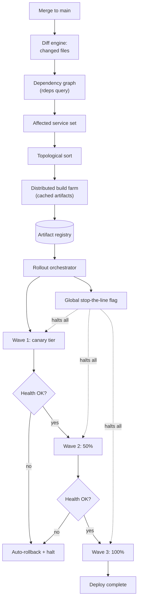
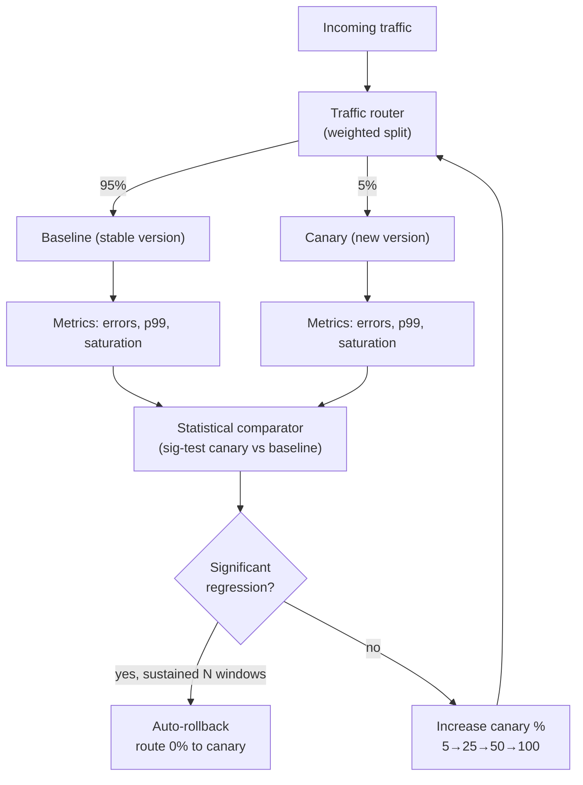
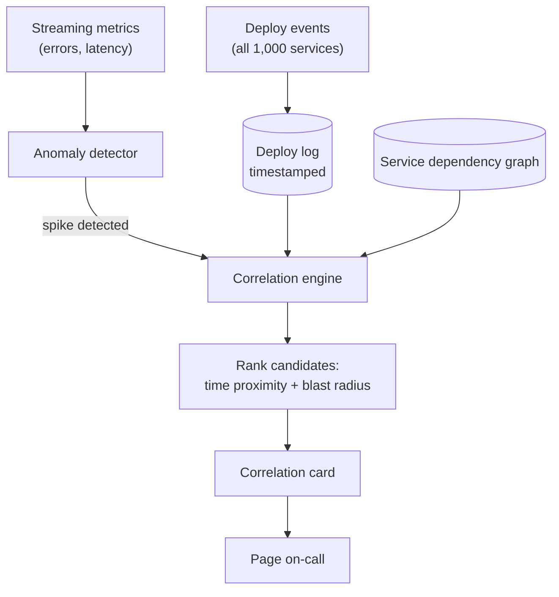
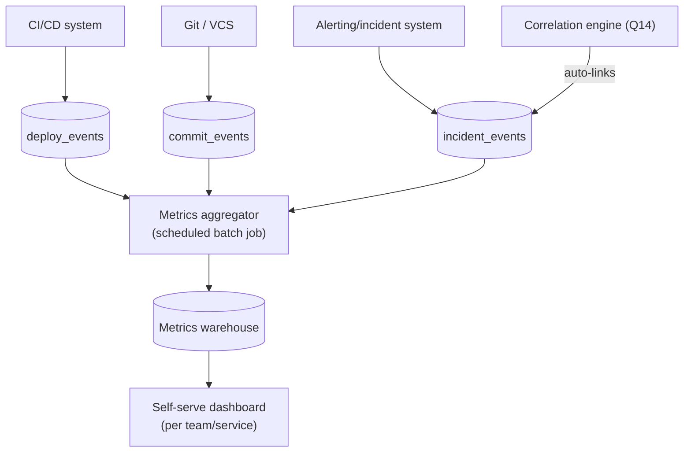
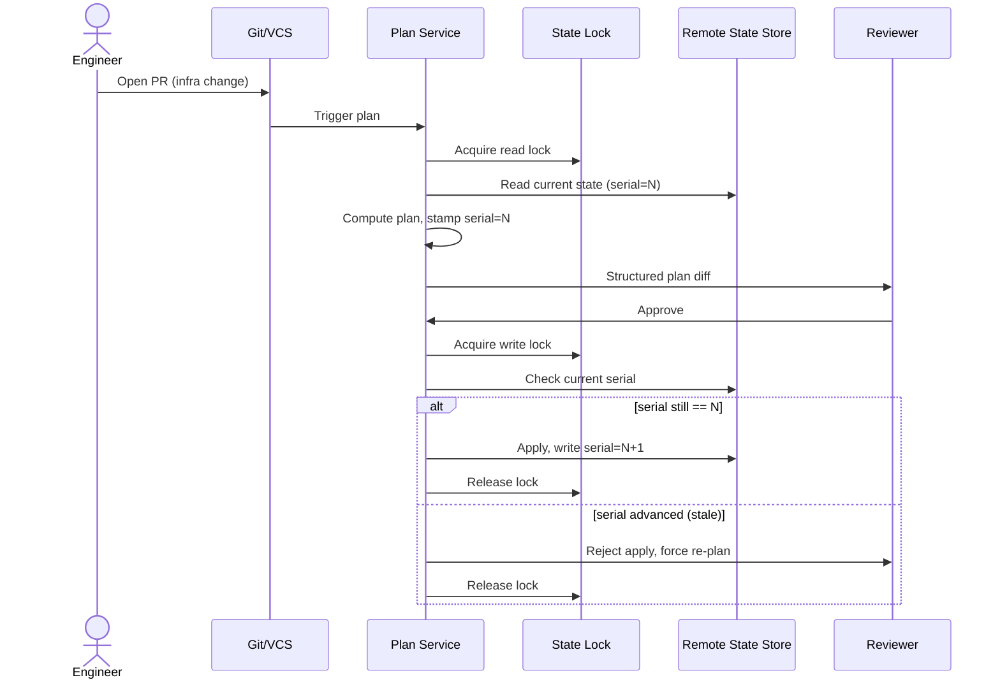
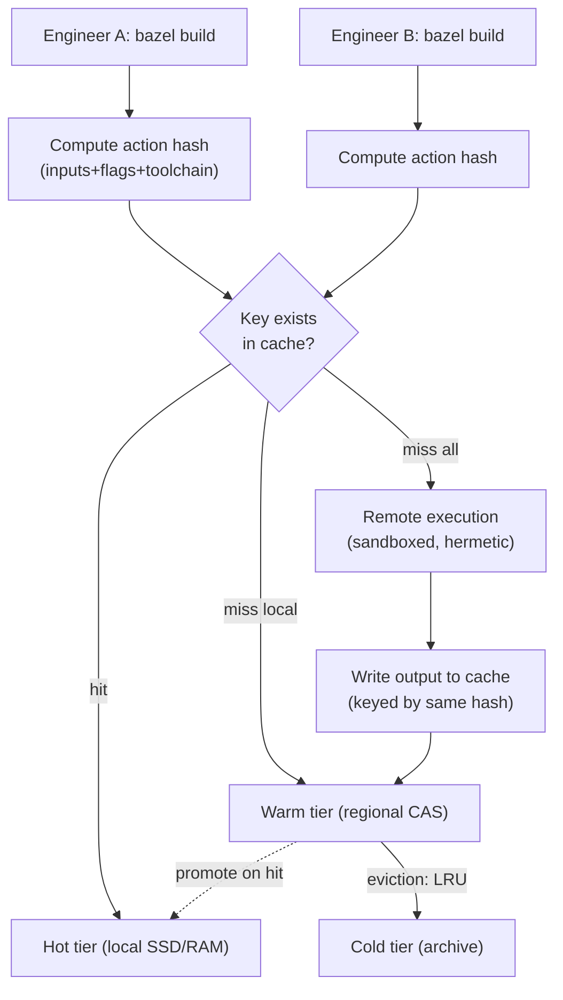
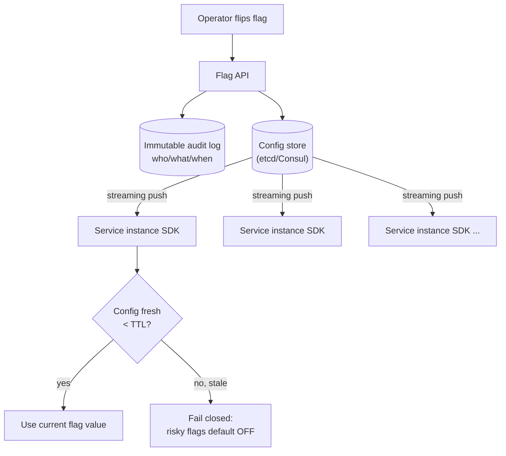
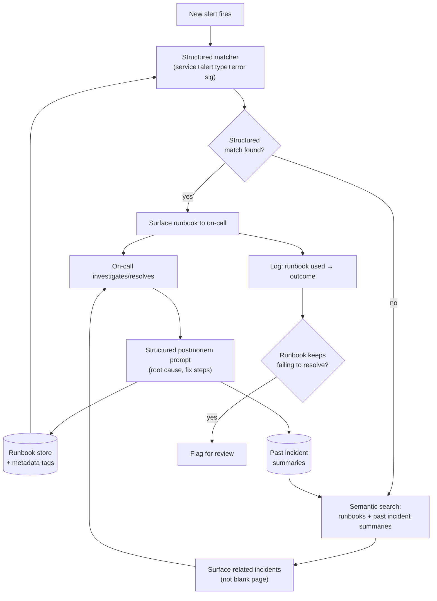

# 30 Practice Questions


Specific to Release Infrastructure (CI/CD, deployment safety, observability/incident response, build systems)
using the same patterns as reported users. Grouped by round type. Languages are (Kotlin/Python/Go).


### A. Craft coding — build something small and working (1–5)
1. **Idempotent deploy-trigger API.**
	- Build a small HTTP service (Kotlin or Python) that accepts a "trigger deployment" request keyed by an idempotency key + service name + git SHA.
	- Duplicate requests with the same key must not trigger a second deployment.
	- Support querying deploy status.
	- Discuss what you'd persist vs. keep in memory, and what happens if the process crashes mid-deploy.
2. **Rate-limited rollback endpoint.**
	- Implement an endpoint that accepts rollback requests for a service, allows at most 3 rollbacks per service per 10-minute window (to prevent flapping), and returns a 429 with a `Retry-After` when exceeded.
	- Extend it to log every accepted rollback to an append-only audit log.
3. **Canary analysis evaluator.**
	- Given a stream of (timestamp, error_count, request_count) tuples for a canary and baseline deployment, write a function that decides PASS/FAIL/CONTINUE based on error-rate delta exceeding a threshold over a rolling window.
	- Handle sparse/missing data points.
4. **Build-cache key generator.**
	- Write a function that computes a cache key for a Bazel-style build target given its source file hashes and the hashes of its declared dependencies (transitive).
	- Discuss cache invalidation correctness — what's the failure mode if you get this wrong?
5. **Change-failure-rate calculator.**
	- Given a stream of deploy events (each with a service, timestamp, and outcome: success/failed/rolled-back), implement a rolling 7-day change-failure-rate metric per service, queryable on demand.
	- Discuss how you'd handle a deploy whose outcome isn't known until hours later (e.g., detected via a downstream alert).

### C. System design — release/infra flavored (12–19)
12. Design a **deployment pipeline** for ~1,000 microservices in a monorepo, where a single merge can affect many services. Cover: what triggers a build, how you determine which services need to redeploy, ordering/dependency-aware rollout, and how you keep a bad deploy from cascading.

13. Design a **canary/progressive-rollout system** from scratch: how you route a percentage of traffic, what signals gate promotion to 100%, how automated rollback triggers, and how you avoid false-positive rollbacks from unrelated noise.

14. Design an **incident-detection and alerting pipeline** that correlates a spike in errors with the most likely recent deploy as the cause, and surfaces that correlation to an on-call engineer within minutes.

15. Design a system to track and report **DORA metrics** (deploy frequency, change failure rate, MTTR, lead time for changes) across hundreds of independently-deploying teams, with a self-serve dashboard. Discuss data model and how you'd avoid teams gaming the numbers.

16. Design **Terraform Cloud-style remote state and plan-review workflow**: how concurrent applies are prevented, how you surface a human-readable diff of a plan before approval, and how you handle a plan that goes stale between review and apply.

17. Design a **build cache/remote-execution service** for a Bazel-like build system serving hundreds of engineers: cache key strategy, storage tiering, eviction policy, and how you keep it correct (never serve a stale/wrong artifact) under concurrent writes.

18. Design a **feature-flag/kill-switch system** that can disable a risky code path across all instances of a service within seconds, without a full redeploy. Cover propagation latency, consistency guarantees, and audit trail.

19. Design an **on-call incident-response knowledge system**: given a new alert, route it to the most relevant runbook, and if none exists, structure how a human's investigation gets captured so the next similar incident resolves faster. (This one directly mirrors a pattern Brex has actually shipped — a good one to have real opinions on.)

Doing all eight (12–19) as compact TDD-style designs. No Mermaid Chart render tool is connected in this chat, so I'm giving you raw Mermaid source (paste into [mermaid.live](https://mermaid.live) or your IDE's Mermaid plugin) plus an ASCII version for each, per the skill's fallback path.

---

## 12. Deployment Pipeline for ~1,000 Microservices in a Monorepo

**Core problem:** a single merge can touch dozens of services; you need to build/test/deploy only what changed, in dependency order, without a bad rollout taking down half the fleet.

**Key mechanisms**
- **Trigger:** merge to main → CI computes the affected-service graph via build-graph analysis (Bazel/Buck-style — file-level ownership mapped to targets), not a full rebuild.
- **Change detection:** diff the merge against the last known-good commit; walk the reverse dependency graph (`bazel query "rdeps(//..., //changed:targets)"` equivalent) to get the transitive closure of affected services.
- **Ordering:** topological sort of the affected subgraph — services with no dependents deploy first, shared libraries' consumers deploy after the library.
- **Blast-radius containment:** deploy in waves (canary tier → 10% → 50% → 100%) per service, gated by automated health checks between waves; a global "stop the line" flag halts all in-flight rollouts if error budgets burn too fast anywhere.



```
                         [Merge to main]
                               │
                               ▼
                     [Diff Engine] → changed files
                               │
                               ▼
                [Dependency Graph / rdeps query]
                               │
                               ▼
                    [Affected Service Set]
                               │
                               ▼
                    [Topological Sort]
                               │
                               ▼
   ┌───────────────[Distributed Build Farm]───────────────┐
   │                   (cached artifacts)                 │
   └───────────────────────┬────────────────────────────--┘
                            ▼
                    [Artifact Registry]
                            │
                            ▼
                  [Rollout Orchestrator] ◄──── [Global Stop-the-Line Flag]
                            │
        ┌───────────────────┼───────────────────┐
        ▼                   ▼                    ▼
   [Wave 1: canary]   [Wave 2: 50%]        [Wave 3: 100%]
        │  health gate      │  health gate        │
        ▼                   ▼                     ▼
   pass → next         pass → next            Deploy complete
   fail → [Auto-rollback + halt all in-flight waves]
```

**Trade-off worth naming:** exact rdeps-based change detection is precise but expensive to compute on huge graphs — most orgs at this scale cache the dependency graph incrementally rather than recomputing it from scratch per merge (Bazel's query cache, or a materialized graph in a service like Google's Blaze/Piper equivalent).

---

## 13. Canary / Progressive-Rollout System

**Core problem:** route a small percentage of real traffic to a new version, decide automatically whether it's healthy enough to promote, and roll back fast — without false alarms from noise unrelated to the deploy.

**Key mechanisms**
- **Traffic routing:** sidecar/service-mesh-level weighted routing (Envoy/Istio-style) — percentage split by request, sticky by user/session hash if statefulness matters.
- **Promotion signals:** compare canary vs. baseline cohort on the *same* metrics window (error rate, p99 latency, saturation) using statistical significance testing, not raw thresholds — this is the piece that prevents false positives from ambient noise.
- **Automated rollback trigger:** if canary error rate exceeds baseline by a statistically significant margin (e.g., z-test or sequential probability ratio test) sustained over N consecutive windows, auto-rollback; single-window blips don't trigger it.
- **Avoiding false-positive rollback:** always compare canary against a live baseline cohort receiving the *same* traffic mix at the *same* time — never against a historical average, which is vulnerable to time-of-day effects, upstream outages unrelated to the deploy, etc.



```
        [Incoming Traffic]
                │
                ▼
        [Traffic Router] (weighted split)
          │               │
     95%  ▼          5%   ▼
   [Baseline]         [Canary]
          │               │
          ▼               ▼
   [Metrics: err/lat] [Metrics: err/lat]
          │               │
          └───────┬───────┘
                   ▼
     [Statistical Comparator]
     (canary vs live baseline,
      same time window)
                   │
                   ▼
          significant regression?
          sustained N windows?
          ┌────────┴────────┐
        yes                 no
          │                 │
          ▼                 ▼
   [Auto-Rollback]   [Promote: 5→25→50→100%]
   route 0% canary          │
                             └──► back to Router
```

**Trade-off worth naming:** comparing against a live baseline cohort (vs. historical average) costs you traffic-splitting complexity and needs enough volume for statistical power — for low-QPS services you may need synthetic/shadow traffic instead.

---

## 14. Incident-Detection Pipeline Correlating Error Spikes with Recent Deploys

**Core problem:** an error spike happens; automatically figure out which of the last N deploys across N services is the likely cause, and get that to an on-call human within minutes.

**Key mechanisms**
- **Deploy event stream:** every deploy (across all 1,000 services) emits a timestamped event to a central deploy-log service — this is the ground truth correlation dataset.
- **Anomaly detection:** streaming metrics pipeline (e.g., Kafka + streaming aggregation) flags a statistically significant deviation in error rate/latency per service.
- **Correlation engine:** when an anomaly fires for service X, query the deploy-log for any deploy to X (or its direct upstream dependencies) within a trailing window (e.g., last 2 hours), ranked by temporal proximity and blast-radius overlap (did the deploy touch the code path implicated by the error signature/stack trace?).
- **Surfacing:** page on-call with a pre-built correlation card: "Error spike in checkout-service at 14:32, most likely cause: deploy #4821 to payments-lib at 14:28 (4 min prior), affects 12 downstream services."



```
   [Deploy Events, all services] ──► [Deploy Log] (timestamped)
                                          │
   [Streaming Metrics] ──► [Anomaly       │
    (errors, latency)]     Detector]      │
                              │           │
                     spike detected       │
                              ▼           ▼
                        [Correlation Engine] ◄── [Service Dependency Graph]
                              │
                              ▼
                [Rank candidates by
                 time proximity + blast radius]
                              │
                              ▼
                     [Correlation Card]
                  "Spike in X at 14:32,
                   likely cause: deploy #4821
                   to Y at 14:28 (4 min prior)"
                              │
                              ▼
                       [Page on-call]
```

**Trade-off worth naming:** temporal correlation isn't causation — you'll get false positives when two unrelated deploys land close together. Mitigate by weighting the ranking with dependency-graph proximity (did the deploy actually touch code in the failing request's call path), not just time.

---

## 15. DORA Metrics Tracking & Reporting Across Hundreds of Teams

**Core problem:** compute deploy frequency, change failure rate, MTTR, and lead time for changes across independently-deploying teams, self-serve, without teams gaming the numbers.

**Data model (event-sourced, not pre-aggregated):**
- `deploy_events(deploy_id, service, team, commit_sha, started_at, completed_at, status)`
- `incident_events(incident_id, service, detected_at, resolved_at, linked_deploy_id, severity)`
- `commit_events(commit_sha, service, authored_at, merged_at)`

All four DORA metrics are *derived* from these three raw event streams — never store the metrics themselves as mutable rows, or teams (or well-meaning dashboards) will "correct" them retroactively.

**Anti-gaming measures**
- Deploy frequency: count deploys from the CI/CD system directly (not self-reported) — a system of record teams don't control.
- Change failure rate: `linked_deploy_id` on incidents must be set automatically by the correlation system from Q14 above, not manually assigned by the team whose deploy is implicated (obvious conflict of interest).
- MTTR: computed from `detected_at`→`resolved_at` timestamps sourced from the incident/alerting system, not self-reported "we fixed it" timestamps.
- Lead time for changes: `merged_at` → `completed_at` (deploy), sourced from git and CI systems respectively — neither system is owned by the team being measured.



```
 [CI/CD System] ──► [deploy_events]
 [Git / VCS]    ──► [commit_events]        ──┐
 [Alerting Sys] ──► [incident_events] ◄──────┤ auto-linked by
                                             │ Correlation Engine (Q14)
                          │                  │  (not self-reported)
                          ▼
                  [Metrics Aggregator]
                  (scheduled batch job,
                   derives all 4 metrics
                   from raw events)
                          │
                          ▼
                  [Metrics Warehouse]
                          │
                          ▼
              [Self-Serve Dashboard]
              (per team / per service)
```

**Trade-off worth naming:** deriving metrics from raw immutable events instead of storing computed rollups costs you
query latency (recompute-on-read or scheduled batch refresh) — but it's the only way to keep the numbers trustworthy
under adversarial incentives (teams whose bonus/perf review ties to DORA metrics *will* find the seams in a self-reported system).

---

## 16. Terraform Cloud-Style Remote State & Plan-Review Workflow

**Core problem:** prevent concurrent applies from corrupting state, show a human-readable plan diff pre-approval, and handle a plan going stale between review and apply.

**Key mechanisms**
- **Concurrency control:** state locking — a workspace-level lock (backed by DynamoDB-style conditional writes, or a Postgres row lock) acquired at plan-start, held through apply, released on completion/failure. Any concurrent `terraform apply` on the same workspace blocks or fails fast.
- **Plan-review diff:** the plan output is structured (JSON plan, not just text) so the UI can render a human-readable resource-level diff (create/update/destroy per resource, attribute-level changes) rather than a raw HCL dump.
- **Stale-plan handling:** every plan is stamped with the state serial/version it was computed against. At apply-time, re-check the current state serial — if it's advanced since the plan was generated (someone else applied in between), reject the apply and force a re-plan rather than applying a plan computed against outdated state.



```
[Engineer] → PR → [VCS] → trigger → [Plan Service]
                                          │
                                   acquire read lock
                                          ▼
                                [State Lock] ◄─────────────┐
                                          │                │
                              read state (serial=N)        │
                                          ▼                │
                              [Remote State Store]         │
                                          │                │
                          compute plan, stamp serial=N     │
                                          ▼                │
                              [Structured plan diff] ──► [Reviewer]
                                                           │
                                                        approve
                                                           ▼
                                              acquire write lock
                                                           │
                                              check current serial
                                          ┌────────────────┴───────────────┐
                                    serial == N                    serial advanced
                                          │                                │
                                          ▼                                ▼
                                  [Apply + serial=N+1]          [Reject: force re-plan]
                                          │                                │
                                          └──────────► release lock ◄──────┘
```

**Trade-off worth naming:** rejecting on stale serial is safe but can frustrate engineers when someone else's unrelated
apply invalidates your reviewed plan — the alternative (allow apply anyway) risks applying a plan computed against
resources that no longer look like what it thinks they look like,
which is a much worse failure mode (silent drift or destructive surprises).

---

## 17. Build Cache / Remote-Execution Service for a Bazel-Like System

**Core problem:** cache build/action outputs for hundreds of engineers, keyed correctly, evicted sanely, and —
the hard part — never served wrong under concurrent writes.

**Key mechanisms**
- **Cache key strategy:** content-addressable — key = hash of (action inputs: source file hashes, tool/compiler version, flags, environment). Same inputs → same key, deterministically, across machines. This is what makes it safe: you're not caching by "target name," you're caching by the actual content that determines the output.
- **Storage tiering:** hot tier (local SSD/NVMe per build cluster node, or an in-memory LRU) → warm tier (regional object store, e.g., S3/GCS-backed CAS) → cold tier (archived/rarely-hit blobs, cheaper storage class).
- **Eviction:** LRU with size-based tiers; because keys are content-addressed, evicting is safe — a cache miss just means a rebuild, never a wrong answer.
- **Correctness under concurrent writes:** because the key is a hash of inputs, two engineers building the same target with the same inputs produce the same key and the same (deterministic) output — writes are idempotent, so concurrent writers don't corrupt each other; last-write-wins is fine because the content should be identical. The actual correctness risk is *non-hermetic* actions (e.g., embedding a timestamp, or reading an untracked env var) producing different outputs for the same key — solved by strict sandboxing/hermeticity enforcement at the build-execution layer, not the cache layer.



```
 [Engineer A: bazel build]        [Engineer B: bazel build]
           │                                 │
   compute action hash                compute action hash
   (inputs+flags+toolchain)           (inputs+flags+toolchain)
           │                                 │
           └───────────────┬─────────────────┘
                            ▼
                  [Key exists in cache?]
              ┌─────────────┼──────────────────┐
            hit          miss (local)      miss (all tiers)
              │              │                    │
              ▼              ▼                    ▼
        [Hot Tier]     [Warm Tier]        [Remote Execution]
      (local SSD/RAM)  (regional CAS)     (sandboxed, hermetic)
              ▲              │                    │
              │ promote      ▼                    ▼
              └────────  eviction: LRU    [Write output to cache]
                              │             (same content-hash key)
                              ▼                   │
                      [Cold Tier (archive)] ◄─────┘
```

**Trade-off worth naming:** content-addressing solves the "serve a wrong artifact" problem for free, but it only holds if actions are truly hermetic — the moment a build action has a side channel (network access, wall-clock time, unpinned dependency), your cache key stops describing your output and you get silent correctness bugs that look like flaky builds.

---

## 18. Feature-Flag / Kill-Switch System

**Core problem:** disable a risky code path fleet-wide within seconds, without a redeploy, with predictable consistency and an audit trail.

**Key mechanisms**
- **Propagation:** flag state lives in a low-latency config store (e.g., etcd/Consul or a purpose-built flag service) that services watch via streaming push (long-poll or gRPC streaming), not polling — this is what gets you seconds, not minutes, of propagation.
- **Consistency guarantee:** eventual consistency is the honest answer at fleet scale — different instances may see the flag flip a few hundred ms apart. For a true kill-switch (must-be-off-everywhere-immediately semantics), pair the push mechanism with a local SDK that fails closed on stale/unreachable config beyond a TTL (i.e., if an instance hasn't heard from the flag service in N seconds, it treats risky flags as off by default) — bias failure mode toward safety, not staleness.
- **Audit trail:** every flag mutation is an immutable event (who, what, when, old value, new value) — never an in-place update to a mutable "current state" row without a paired log entry.



```
        [Operator flips flag]
                 │
                 ▼
            [Flag API] ──────► [Immutable Audit Log]
                 │              (who/what/when/old→new)
                 ▼
          [Config Store] (etcd/Consul)
                 │
     streaming push (not polling)
    ┌────────────┼─────────────┐
    ▼            ▼             ▼
[SDK inst 1] [SDK inst 2] [SDK inst N]
    │
    ▼
[Config fresh < TTL?]
  ┌──────┴───────┐
 yes            no (stale)
  │              │
  ▼              ▼
[Use flag]  [Fail closed:
             risky flag → OFF]
```

**Trade-off worth naming:** fail-closed-on-stale is the right default for a kill-switch, but it's the wrong default for a feature-rollout flag (you don't want every gradual-rollout flag reverting to 0% the moment a config-service blip happens) — this needs to be a per-flag-type policy, not a system-wide constant.

---

## 19. On-Call Incident-Response Knowledge System (Brex-style runbook routing)

**Core problem:** route a new alert to the most relevant runbook; if none exists, capture the human's investigation so the next similar incident resolves faster automatically.

**Key mechanisms**
- **Alert → runbook matching:** each runbook is tagged with structured metadata (service, alert type, error signature/regex, affected dependency) at authoring time. On a new alert, match against this metadata first (fast, deterministic) — fall back to semantic/embedding search over runbook content + historical incident summaries only when there's no structured match (handles novel-but-similar alerts).
- **No-runbook path:** if no match, page the human with the raw alert plus *related* past incidents (via the same semantic search) as context, not a blank page. This is the key UX move — don't make on-call start from zero.
- **Knowledge capture loop:** after resolution, the incident's structured postmortem (what was the root cause, what commands/queries were run, what fixed it) is prompted from the on-call engineer as a lightweight structured form, not free-text notes buried in a Slack thread — this structured capture is what becomes tomorrow's runbook or gets appended to an existing one as a new "variant."
- **Feedback loop closing:** every time a runbook is used to resolve an incident, log a usage + outcome (did it actually fix it) so runbooks that stop working (because the system changed underneath them) get flagged for review rather than silently rotting.



```
                    [New Alert Fires]
                            │
                            ▼
                  [Structured Matcher] ◄──── [Runbook Store + metadata tags]
                            │
                  structured match found?
              ┌─────────────┴───────────────┐
            yes                            no
              │                             │
              ▼                             ▼
   [Surface Runbook]              [Semantic Search] ◄── [Past Incident Summaries]
              │                             │
              │                   [Surface related incidents]
              │                     (context, not blank page)
              └──────────────┬──────────────┘
                              ▼
                   [On-Call Investigates/Resolves]
                              │
                              ▼
              [Structured Postmortem Prompt]
              (root cause, fix steps — not free text)
                    │                    │
                    ▼                    ▼
           [Runbook Store]      [Incident History]
                    ▲
                    │
          [Usage Log: runbook → outcome]
                    │
          keeps failing to resolve?
                    │
                   yes
                    ▼
            [Flag Runbook for Review]
```

**Trade-off worth naming:** structured-metadata matching is fast and cheap but only as good as the tagging discipline at
authoring time — semantic search is the safety net for drift and novel incidents, but it's slower and noisier, which is
exactly why it should be the fallback, not the primary path.
